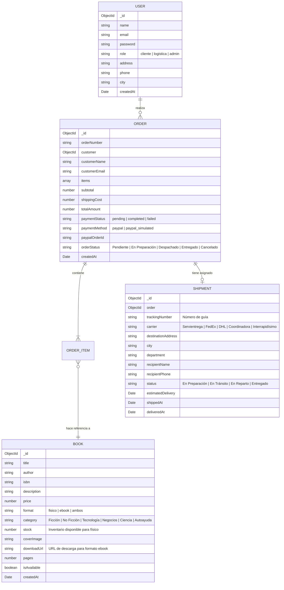

# 📚 PRD - Plataforma de Comercio Electrónico de Libros (BookHub)

> **Documento de Requisitos de Producto, Arquitectura y Especificación Técnica**
> Fecha: Noviembre 2026 | Versión: 1.0

---

## 1. Visión General del Producto
**BookHub** es una solución integral de comercio electrónico para la venta, distribución y gestión de libros en formato **híbrido**: libros físicos (con control estricto de inventario, bodega y logística de envíos) y libros electrónicos / e-books (con entrega digital inmediata y biblioteca virtual post-compra).

El sistema cuenta con actualización bidireccional en tiempo real vía WebSockets (**Socket.io**), pasarela de pagos integrada (**PayPal Sandbox** + **Simulador de Pago Inmediato**), control de acceso basado en roles (**RBAC** con JWT y cookies HttpOnly) y un **Tablero Kanban de Logística y Despacho en Tiempo Real** para el seguimiento en vivo de pedidos y envíos.

---

## 2. Arquitectura del Sistema (Seleccionada)
Se implementa una **Arquitectura Monolítica Modular Full-Stack**:
- **Frontend y Backend unificados**: Next.js 16 (App Router) con React 19 y Server/Client Components.
- **Servidor HTTP y WebSockets**: Node.js unificado (`server.js`) con `socket.io` y Next.js Request Handler.
- **Capa de Persistencia**: MongoDB Atlas / Local con ODM **Mongoose**.
- **Estilos**: Tailwind CSS 4.
- **Autenticación**: JSON Web Tokens (JWT) firmados con clave secreta y contraseñas hasheadas con `bcryptjs`.
- **Pagos**: Pasarela PayPal REST API v2 + Pasarela de Simulación Instantánea para pruebas y sustentaciones.

```mermaid
flowchart TD
    ClientBrowser["Navegador del Usuario (React 19 / Next.js)"]
    AdminBrowser["Tablero Logístico / Admin (Kanban en Vivo)"]
    
    subgraph AppServer ["Servidor Unificado Node.js (server.js - Puerto 3000)"]
        NextEngine["Next.js 16 App Router\n(SSR / CSR / API Routes)"]
        SocketServer["Servidor Socket.io\n(Rooms: 'logistics', 'order:id', 'stock')"]
        AuthMiddleware["Middleware de Autenticación & RBAC\n(JWT en cookies HttpOnly)"]
    end
    
    subgraph DataStorage ["Base de Datos"]
        MongoDB[("MongoDB Database\n(Users, Books, Orders, Shipments)")]
    end

    subgraph Payments ["Pasarelas de Pago"]
        PayPalGateway["PayPal Sandbox API"]
        SimulatedGateway["Motor de Simulación de Pago"]
    end

    ClientBrowser <-->|HTTP / API REST| NextEngine
    ClientBrowser <-->|WebSockets (Eventos de Orden)| SocketServer
    AdminBrowser <-->|WebSockets (Kanban en Vivo / Stock)| SocketServer
    NextEngine --> AuthMiddleware
    AuthMiddleware --> MongoDB
    NextEngine --> Payments
    SocketServer <--> MongoDB
```

---

## 3. Matriz de Roles y Reglas de Autorización (RBAC)

El sistema define 3 roles de usuario claramente segregados:

| Rol | Descripción | Permisos Clave | Rutas Protegidas |
| :--- | :--- | :--- | :--- |
| **`cliente`** | Comprador registrado | • Explorar catálogo y filtrar por categoría/formato<br>• Gestionar carrito y comprar<br>• Acceder a su historial de pedidos y tracking en vivo<br>• Acceder a su "Biblioteca Digital" para descargar e-books | `/checkout`, `/pedidos`, `/pedidos/[id]`, `/biblioteca` |
| **`logistica`** | Operador de almacén y despachos | • Ver y operar el Tablero Kanban de Envíos en tiempo real<br>• Cambiar estados de órdenes y registrar guías de transportadora<br>• Consultar niveles de stock | `/logistica`, `/logistica/envios` |
| **`admin`** | Administrador del sistema | • Control total de catálogo (Crear, Editar, Eliminar libros)<br>• Ajustar inventario/stock manualmente<br>• Supervisión general de órdenes, envíos y usuarios | `/admin`, `/admin/libros`, `/admin/inventario`, `/logistica` |

### Reglas de Seguridad en Middleware y APIs
1. **Tokens JWT**: Firmados con algoritmo `HS256`, expiración de 7 días, almacenados en cookies `HttpOnly` y `SameSite: Lax`.
2. **Control de Propiedad**: Un cliente solo puede consultar órdenes (`/api/orders/[id]`) que le pertenezcan a su `customerId`. Administradores y operadores de logística pueden consultar cualquier orden.
3. **Validación de Stock**: En el endpoint de creación de orden, se verifica que cada libro físico tenga `stock >= cantidad`. Si hay stock insuficiente, la transacción se rechaza. Al confirmarse el pago, el stock se decrementa atómicamente.

---

## 4. Modelos de Datos (Mongoose / TypeScript)



---

## 5. Endpoints Documentados de la API REST

### 5.1. Autenticación (`/api/auth`)
| Método | Ruta | Rol Requerido | Descripción | Request Body / Query | Respuesta Exitosa |
| :--- | :--- | :--- | :--- | :--- | :--- |
| `POST` | `/api/auth/register` | Público | Registra un nuevo usuario | `{ name, email, password, role?, address, phone, city }` | `201 Created` + Cookie JWT + `{ user }` |
| `POST` | `/api/auth/login` | Público | Inicia sesión y emite cookie JWT | `{ email, password }` | `200 OK` + Cookie JWT + `{ user }` |
| `POST` | `/api/auth/logout` | Autenticado | Cierra sesión eliminando cookie | Ninguno | `200 OK` + `{ message: "Sesión cerrada" }` |
| `GET` | `/api/auth/me` | Autenticado | Obtiene datos del usuario actual | Headers con Cookie JWT | `200 OK` + `{ user }` |

### 5.2. Catálogo e Inventario (`/api/books`)
| Método | Ruta | Rol Requerido | Descripción | Request Body / Query | Respuesta Exitosa |
| :--- | :--- | :--- | :--- | :--- | :--- |
| `GET` | `/api/books` | Público | Lista libros con filtros | Query: `?category=&format=&search=&inStock=` | `200 OK` + `[ books ]` |
| `GET` | `/api/books/[id]` | Público | Detalle de un libro específico | Param: `id` | `200 OK` + `{ book }` |
| `POST` | `/api/books` | `admin` | Crea un nuevo libro en catálogo | `{ title, author, isbn, price, format, category, stock, coverImage, downloadUrl, pages }` | `201 Created` + `{ book }` |
| `PATCH` | `/api/books/[id]` | `admin`, `logistica` | Actualiza datos o ajusta stock | `{ stock?, price?, isAvailable?, ... }` | `200 OK` + `{ book }` |
| `DELETE` | `/api/books/[id]` | `admin` | Elimina libro del catálogo | Param: `id` | `200 OK` + `{ message }` |

### 5.3. Pedidos (`/api/orders`)
| Método | Ruta | Rol Requerido | Descripción | Request Body / Query | Respuesta Exitosa |
| :--- | :--- | :--- | :--- | :--- | :--- |
| `GET` | `/api/orders` | Autenticado | Lista pedidos (filtrados por usuario para `cliente`, todos para `admin`/`logistica`) | Query: `?status=&page=` | `200 OK` + `[ orders ]` |
| `GET` | `/api/orders/[id]` | Autenticado | Detalle completo de orden | Param: `id` | `200 OK` + `{ order, shipment }` |
| `POST` | `/api/orders` | `cliente` | Crea un nuevo pedido con validación de stock | `{ items: [{ bookId, quantity, format }], shippingAddress: { ... }, paymentMethod }` | `201 Created` + `{ order }` + Emite Socket |
| `PATCH` | `/api/orders/[id]/status`| `logistica`, `admin`| Actualiza estado de pedido en el Kanban | `{ status: "En Preparación" \| "Despachado" \| "Entregado" }` | `200 OK` + `{ order }` + Emite Socket |

### 5.4. Pagos (`/api/payments`)
| Método | Ruta | Rol Requerido | Descripción | Request Body | Respuesta Exitosa |
| :--- | :--- | :--- | :--- | :--- | :--- |
| `POST` | `/api/payments/create-paypal-order` | `cliente` | Inicializa orden en PayPal Sandbox | `{ orderId, amount }` | `200 OK` + `{ id: paypalOrderId }` |
| `POST` | `/api/payments/capture-paypal-order`| `cliente` | Captura fondos y confirma orden | `{ orderId, paypalOrderId }` | `200 OK` + `{ status: "completed" }` |
| `POST` | `/api/payments/simulate` | `cliente` | Simula pago instantáneo exitoso | `{ orderId }` | `200 OK` + `{ status: "completed" }` |

### 5.5. Envíos y Logística (`/api/shipments`)
| Método | Ruta | Rol Requerido | Descripción | Request Body | Respuesta Exitosa |
| :--- | :--- | :--- | :--- | :--- | :--- |
| `GET` | `/api/shipments` | `logistica`, `admin`| Lista todos los envíos activos | Query: `?status=&carrier=` | `200 OK` + `[ shipments ]` |
| `PATCH`| `/api/shipments/[id]` | `logistica`, `admin`| Asigna transportadora, número de guía y estado | `{ trackingNumber, carrier, status, estimatedDelivery }` | `200 OK` + `{ shipment }` + Emite Socket |
| `GET` | `/api/shipments/track/[trackingNumber]` | Público/Cliente | Rastreo público de guía | Param: `trackingNumber` | `200 OK` + `{ trackingInfo }` |

---

## 6. Eventos en Tiempo Real (WebSockets / Socket.io)

El servidor centraliza los eventos bidireccionales en `server.js`:

| Evento | Dirección | Payload | Propósito |
| :--- | :--- | :--- | :--- |
| `join:logistics` | Cliente -> Servidor | `{ role: 'logistica' \| 'admin' }` | Operador se une a la sala de logística para ver el Kanban en vivo |
| `join:order` | Cliente -> Servidor | `orderId` | Comprador se suscribe a los cambios de estado de su orden específica |
| `order:created` | Servidor -> Clientes (`logistics`) | `{ order }` | Notifica al Kanban la entrada de un nuevo pedido en tiempo real |
| `order:update_status` | Cliente -> Servidor | `{ orderId, status, trackingNumber?, carrier? }` | Operador mueve tarjeta en el Kanban o despacha orden |
| `order:status_updated` | Servidor -> Clientes (`logistics` + `order:id`) | `{ orderId, status, shipment? }` | Actualiza en vivo la tarjeta del Kanban y la pantalla del cliente |
| `stock:updated` | Servidor -> Clientes (`catalog`) | `{ bookId, newStock }` | Actualiza la disponibilidad del libro en el catálogo sin recargar |

---

## 7. Requisitos Funcionales y Vistas de Usuario

1. **Catálogo de Libros (`/catalogo` y `/`)**:
   - Selector de formato: Físico, E-book (Digital) o Ambos.
   - Filtros por categoría: Ficción, No Ficción, Tecnología, Negocios, Ciencia, Autoayuda.
   - Búsqueda en vivo por título, autor o ISBN.
   - Indicador visual de Stock en tiempo real (*"X unidades disponibles"* o *"Agotado"* para libros físicos; *"Disponible para descarga instantánea"* para e-books).
2. **Carrito de Compras y Checkout (`/carrito`, `/checkout`)**:
   - Soporte para items mixtos (libros físicos con tarifa de envío calculada y e-books sin costo de envío).
   - Verificación de stock antes de proceder al pago.
   - Formulario de dirección de envío para libros físicos con ciudad y departamento.
   - Selector de pasarela de pago: PayPal Sandbox o Simulación de Pago Inmediato.
3. **Biblioteca Digital del Cliente (`/biblioteca`)**:
   - Panel donde el cliente puede consultar y descargar inmediatamente todos los e-books adquiridos tras completar su compra.
4. **Tablero Kanban de Logística y Envíos en Tiempo Real (`/logistica`)**:
   - 4 Columnas operativas:
     1. 🟡 **Pendiente de Alistamiento** (Pagado, esperando embalaje)
     2. 🔵 **En Preparación / Empaque** (Libro separado en bodega)
     3. 🚚 **Despachado / Con Guía** (Asignación de Transportadora y Número de Rastreo)
     4. 🟢 **Entregado** (Despacho finalizado satisfactoriamente)
   - Funcionalidad Drag & Drop y botones de acción rápida.
   - Modal para asignar transportadora (Servientrega, FedEx, DHL, etc.) y número de guía con cálculo de entrega estimada.
5. **Panel de Gestión de Catálogo y Stock (`/admin/libros`)**:
   - Formulario de creación y edición de libros (físico/e-book, stock inicial, precio, portada, URL de descarga).
   - Ajuste rápido de stock con alerta de inventario bajo.
6. **Seguimiento de Pedido en Vivo (`/pedidos/[id]`)**:
   - Barra de progreso interactiva que avanza en tiempo real vía WebSockets sin recargar la página.
   - Detalles de la transportadora y botón para ver el número de guía.
